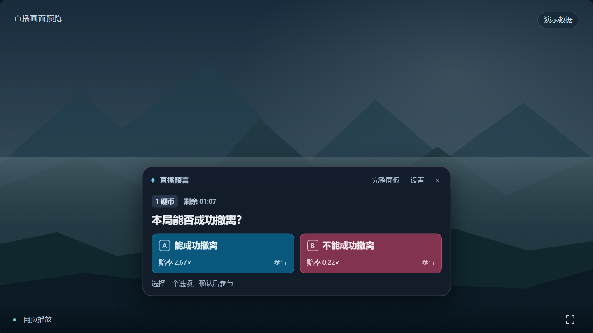
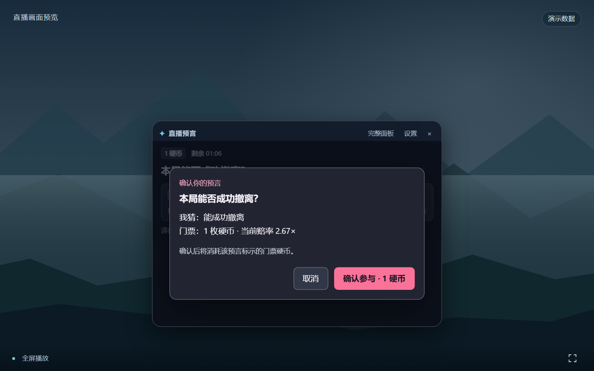
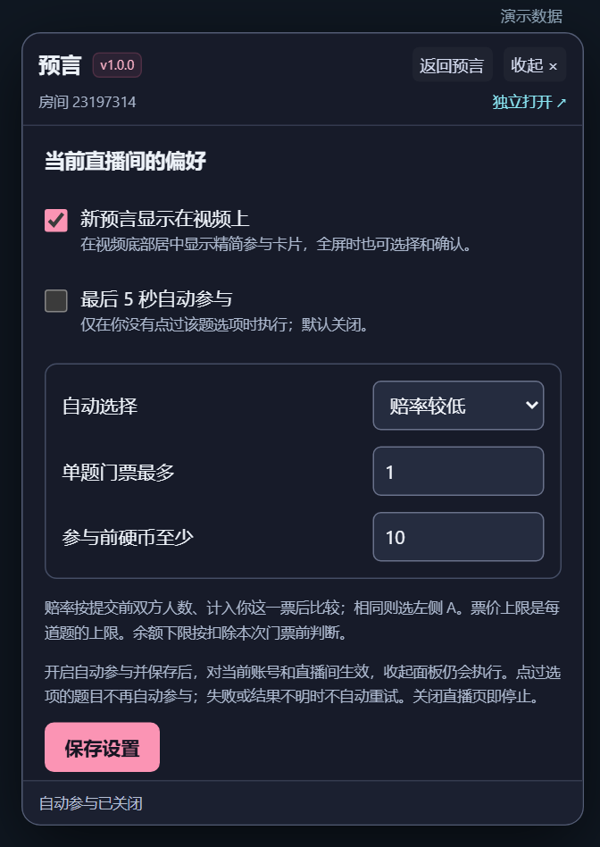

# B 站直播预言

在 PC 直播间查看并参与 App 中的「预言」（硬币竞猜）。提供视频下方居中的精简参与卡片、全屏浮窗，以及可选的最后 5 秒自动参与。

**[安装脚本](https://raw.githubusercontent.com/Glasden/bili-live-prophecy/main/bili-live-prophecy.user.js)** · [安装与使用](#安装与使用) · [更新记录](CHANGELOG.md)



*界面截图使用演示题目与模拟账户；不是实时直播数据。此项目为非官方浏览器脚本。*

## 安装与使用

### 1. 安装 Tampermonkey（油猴）

打开对应浏览器的官方扩展商店，点击「获取／添加至浏览器」，确认安装：

- **[Microsoft Edge](https://microsoftedge.microsoft.com/addons/detail/tampermonkey/iikmkjmpaadaobahmlepeloendndfphd)**
- **[Google Chrome](https://chromewebstore.google.com/detail/tampermonkey/dhdgffkkebhmkfjojejmpbldmpobfkfo)**
- 其他浏览器的下载入口见 [Tampermonkey 官网](https://www.tampermonkey.net/)。浏览器交互已在 Edge 155 的模拟接口环境中验证，范围见[验证说明](docs/VERIFICATION.md)。

Chrome / Edge 安装后，在地址栏打开 `chrome://extensions` / `edge://extensions`，进入 Tampermonkey 的「详情」，开启 **「允许用户脚本」**（若显示此项）。旧版浏览器或未显示此开关时，按扩展提示及 [Tampermonkey 官方说明](https://www.tampermonkey.net/faq.php?q=Q209) 启用所需权限；部分版本使用「开发者模式」。[Chrome 138 起的权限说明](https://developer.chrome.com/docs/extensions/reference/api/userScripts#chrome_versions_138_and_newer_allow_user_scripts_toggle)可供参考。

### 2. 安装本脚本

点击 **[安装脚本](https://raw.githubusercontent.com/Glasden/bili-live-prophecy/main/bili-live-prophecy.user.js)**，在 Tampermonkey 弹出的页面点击「安装」。

如果只看到源码：打开 Tampermonkey →「添加新脚本」，删除编辑器中的模板，粘贴完整源码，按 `Ctrl+S` 保存。此方式也适用于 GitHub Raw 链接未被扩展识别的情况，参见 [官方安装说明](https://www.tampermonkey.net/faq.php?q=Q102)。

### 3. 打开直播间参与

在浏览器登录 B 站，打开支持预言的直播间，例如 [23197314](https://live.bilibili.com/23197314)，刷新页面后点击右侧 **「预言」** 入口。

有新的可参与题目时，视频下方会出现卡片：**选择 A / B → 检查选项与门票 → 确认参与**。多个开放题目可以前后切换；「完整面板」可查看列表、历史和规则。「×」收起后，可以通过「预言」入口重新展开。

## 全屏也能参与

精简浮窗跟随视频居中靠下，预留控制栏空间；进入、退出全屏时保留当前面板，支持在全屏中选择、确认及收起重开。



## 可选设置

点击浮窗右上角 **「设置」**，修改后保存。自动参与**默认关闭**，开启时需要确认当前登录账号。

| 设置 | 默认值 | 作用 |
| --- | --- | --- |
| 新题视频浮层 | 开启 | 新预言出现时显示精简卡片 |
| 最后 5 秒自动参与 | 关闭 | 没有手动选择时，在截止前尝试参与 |
| 自动选择 | 赔率较低 | 可选赔率较高或较低；相同则选 A |
| 单题门票最多 | 1 枚 | 每道题允许消耗的硬币上限 |
| 参与前硬币至少 | 10 枚 | 参与前余额下限，同时必须付得起门票 |



余额下限检查的是**参与前余额**：下限 10、票价 1 时，余额为 10 可以参与，参与后可能剩 9。

手动点过某道题的选项后，即使取消确认，也不会再自动参与该题。收起浮窗后自动模式仍可运行；要停止，请关闭自动开关或关闭直播页。电脑休眠、断网或后台节流可能导致错过截止时间。

## 更新与常见问题

- **从旧版升级：** 在已有脚本的编辑页用新版完整源码替换并保存，刷新直播间。原有设置会保留；只启用一份脚本。1.0.0 已配置本仓库作为后续更新来源。
- **看不到入口：** 检查扩展与脚本是否启用、是否允许用户脚本，然后刷新数字房间地址下的直播页。
- **当前没有题目／不能参与：** 需要主播正在开放预言，并满足官方参与条件。脚本不会创建题目；已封盘或已参与时不能再次参与。
- **全屏兼容性：** 已验证 Edge 155 的播放器容器全屏、网页全屏和页面直接请求视频全屏。浏览器媒体菜单的原生全屏、跨文档播放器和关闭的 Shadow DOM 尚未验证。

## 开发与验证

安装只需根目录的 `bili-live-prophecy.user.js`，无需构建。开发测试需要 Node.js 20 或更新版本，无第三方依赖：

```bash
npm test
```

验证范围与实现说明见 [docs/VERIFICATION.md](docs/VERIFICATION.md)。本项目复用官方预言 H5 与 SDK，在本地浏览器处理登录状态，不要求提供 App Token。

[MIT License](LICENSE)。B 站官方页面、SDK 与商标归各自权利人所有。
